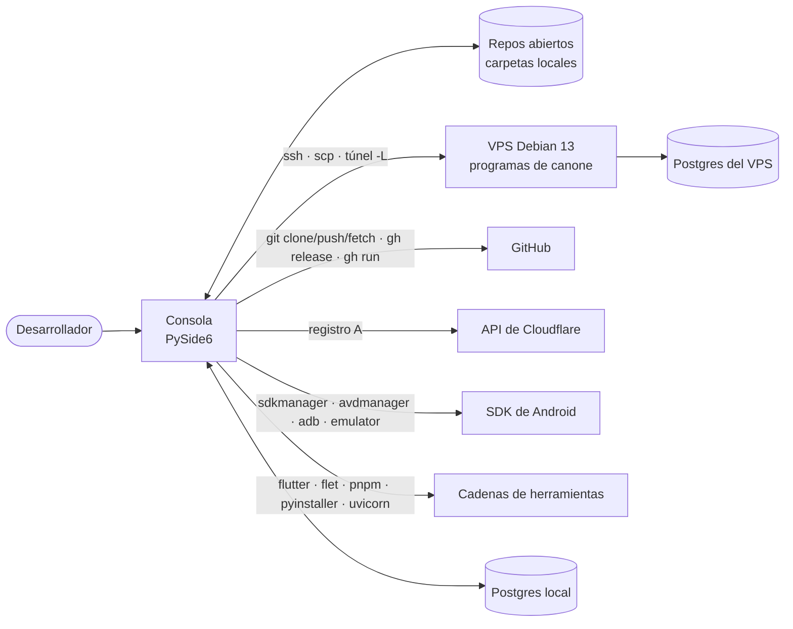

# 01 · Contexto y alcance

## 1. Qué es

Aplicación de escritorio (PySide6) que ejecuta las operaciones de desarrollo y de operación de **los repositorios que se le abren como pestañas**: levantar los servidores de desarrollo, compilar, aprovisionar y operar un VPS, administrar la base de datos y el SDK de Android. Despliega corriendo los programas de canone, sin reimplementarlos ([15](15_vps_y_despliegue.md)).

Consola es un repositorio más de canone: cumple sus convenciones sin ADR de desviación, y lo que todavía no cumple se anota en el [30](30_riesgos_y_pendientes.md).

Reemplaza a una carpeta `scripts/` que cada repositorio arrastraba copiada. La lógica vive una sola vez, en la app, y se aplica a cualquier repo abierto.

| Principio | Cómo se ve en el código |
|---|---|
| Un botón ejecuta una función Python, no un script | Nada invoca `python scripts/x/y.py`; el único `subprocess` es a binarios externos reales (`git`, `gh`, `ssh`, `ssh-keygen`, `flutter`, `pnpm`, `adb`, `psql`, `pyinstaller`) o a un programa de canone |
| La capacidad se declara y se implementa por separado | `core/catalog.py` declara la forma; `core/tasks/` le da cuerpo con `Registry.bind` ([ADR-0002](../adr/0002-catalogo-declara-tareas-implementan.md)) |
| Lo que varía es un eje del panel, no otro botón | `systemd_action` tiene nueve acciones y un eje; no hay nueve botones ([ADR-0004](../adr/0004-un-boton-por-capacidad.md)) |
| La forma del repo decide qué se ofrece | Las apps, las SPA y el servidor salen de mirar las carpetas (`core/targets.py`); un repo sin migraciones no tiene el botón «Migrar» |
| Nada del núcleo conoce la interfaz | `core/` informa por el `TaskContext` que recibe ([ADR-0005](../adr/0005-todo-pasa-por-taskcontext.md)). No importa PySide6, salvo `core/tasks/`, que usa QtGui y QtSvg como biblioteca de imágenes ([ADR-0055](../adr/0055-los-iconos-salen-del-logo-y-los-rasteriza-qt.md)) |
| Lo destructivo se frena por repo | El seguro mira qué rompe la corrida con esos parámetros, no si el botón «es peligroso» ([ADR-0018](../adr/0018-seguro-por-repo-y-objetivo.md)) |

## 2. Qué no es

- **No es un servidor ni un agente.** No corre nada propio en el VPS: lo que deja allá son paquetes de apt, uv, el swap, lo que instalan `install.py` y `credentials.py`, y el ejecutable que sube «Compilar ejecutable».
- **No es multiusuario ni remoto.** Corre en la máquina de una persona, con sus llaves SSH (`~/.ssh`) y sus SDK.
- **No edita el código de los repos que administra.** Los únicos archivos que escribe dentro de un repo son suyos: `.consola/`, `releases/<app>/<plataforma>.json` y el manifiesto de versión del ejecutable ([ADR-0059](../adr/0059-desplegar-con-los-programas-de-canone.md)). Aparte están las imágenes del grupo Imágenes: las capturas reveladas y los íconos de las apps ([19](19_imagenes.md)).

## 3. Restricciones

| Restricción | Detalle |
|---|---|
| Lenguaje y GUI | Python 3.13 y PySide6, con uv (`desktop/pyproject.toml`) |
| Base de datos | `psycopg[binary]` ≥ 3.2, solo para el explorador y sus consultas de introspección |
| Sistemas | Windows y Linux (Debian/Ubuntu para Postgres y la terminal). Todo lo que difiere vive en `core/host.py`, una clase por sistema; nadie más pregunta `os.name` ([ADR-0048](../adr/0048-las-diferencias-de-sistema-viven-en-host.md)). Nunca se corrió en Linux ([30](30_riesgos_y_pendientes.md)) |
| VPS soportado | Debian 13, como lo fija canone (`core/canone.py`) |
| Imágenes | `Pillow` para revelar las capturas y armar el `.ico`; QtSvg, que viene con PySide6, para rasterizar el logo ([19](19_imagenes.md)) |
| Sin dependencias de terceros más allá de esas tres | La RAM se lee sin `psutil`, el HTTP se hace con la biblioteca estándar (`core/tasks/utils.py`) |
| Pruebas solo de lo que no toca otras máquinas | `tests/` cubre lógica pura y las respuestas de `core/host.py` para los dos sistemas ([30](30_riesgos_y_pendientes.md)) |
| Sin telemetría ni red propia | Solo sale a internet para la API de GitHub, la de Cloudflare y las descargas de los SDK |

## 4. Contexto (C4 nivel 1)

## 5. Alcance del catálogo

56 capacidades registradas: 53 con botón y 3 ocultas (`stop_emulator`, `bump_version`, `upload_to_vps`), que existen como paso de otras o como acción de la interfaz. 43 atómicas y 13 compuestas (`Capability.is_composite`). Todas tienen cuerpo salvo `dev_env`, que por diseño no lo tiene: su cuerpo es el despachador de la interfaz ([ADR-0011](../adr/0011-compuesta-concurrente-sin-cuerpo.md)).

| Grupo | Botones | Qué resuelve |
|---|---|---|
| Ejecutar | 5 | Levantar lo que corre en desarrollo: backend, SPA, app móvil, app de escritorio, y todo junto |
| Compilar | 5 | Compilar: Flutter/Flet, Vite y el ejecutable, que además se publica; SPA nueva y limpieza de artefactos |
| Imágenes | 4 | Los íconos de las apps a partir del logo, y las capturas publicables: sacarlas, revelarlas y las dos juntas |
| Repositorio | 4 | Clonar, los dos forzados contra origin desde esta máquina ([ADR-0061](../adr/0061-los-forzados-corren-en-esta-maquina.md)), y la sincronización de archivos entre repos |
| Base de datos | 12 | Ciclo de vida del esquema, migraciones, datos, respaldo, túnel y explorador |
| Despliegue | 4 | Publicar, firmar y desplegar versiones con el `deploy.py` de canone, y los servicios systemd del VPS: acciones y logs |
| VPS | 10 | Preparar el VPS con los programas de canone, diagnóstico: paquetes, credenciales, DNS, salud, eventos, comandos sueltos y revocación |
| Emuladores | 4 | Imágenes de sistema, dispositivos virtuales, arranque y limpieza de disco |
| SDKs | 5 | Dejar esta máquina lista para compilar: Android y Flutter |

## 6. Interesados

| Quién | Qué espera |
|---|---|
| El desarrollador que la usa | Que un botón haga lo que dice, sobre el repo que tiene abierto, y que lo destructivo no se dispare en el repo equivocado |
| Los repos administrados | Que Consola no les escriba código: solo su carpeta `.consola/` y lo que declaran como generado |
| El VPS | Que Consola no escriba encima de lo que instalan los programas de canone ([ADR-0059](../adr/0059-desplegar-con-los-programas-de-canone.md)) |
